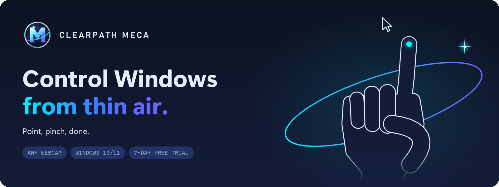
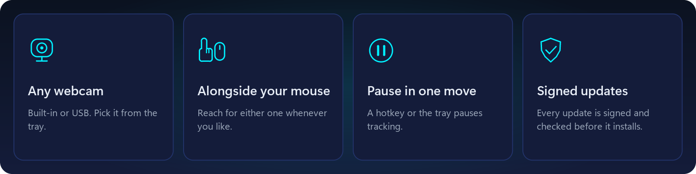
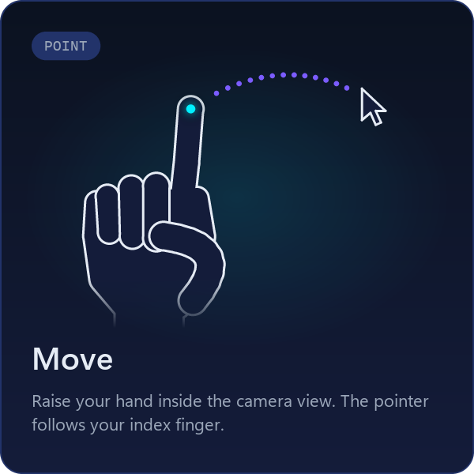
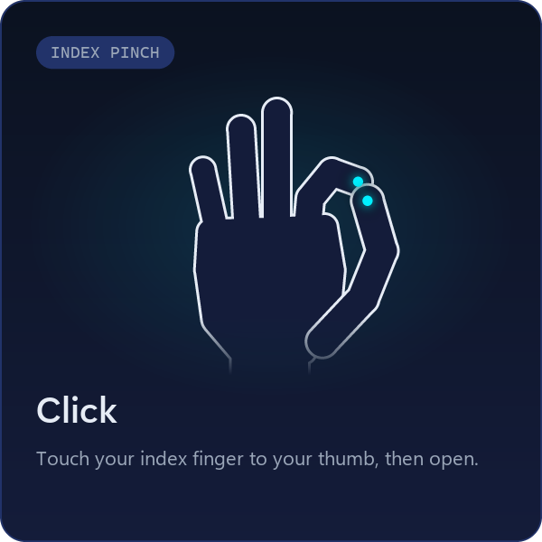
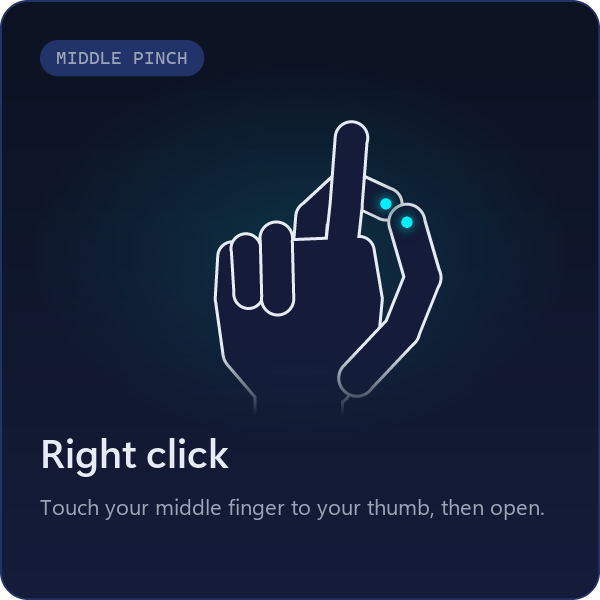
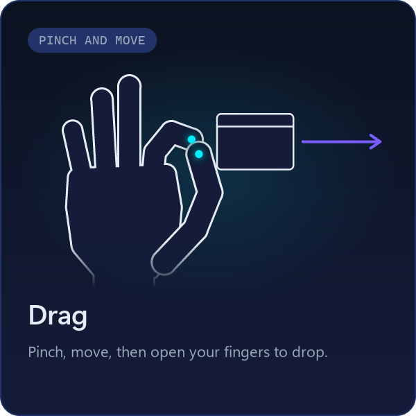
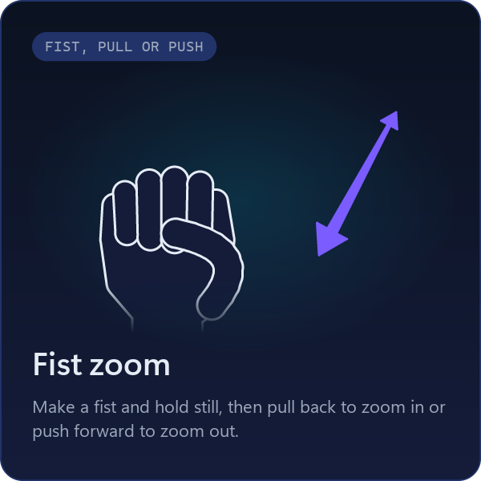
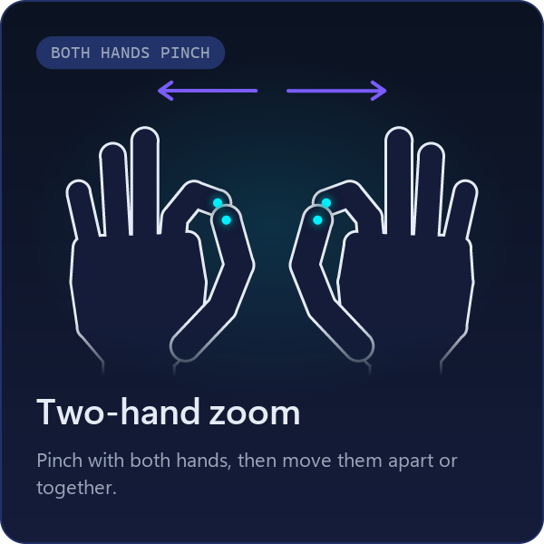
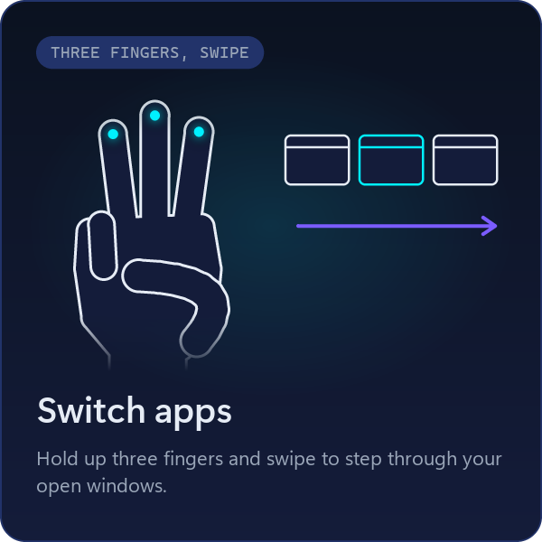
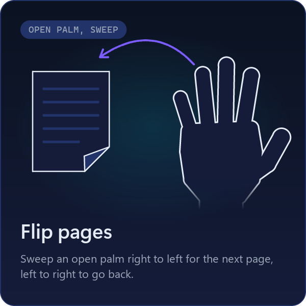

### Control Windows from thin air. **Point, pinch, done.**

**ClearPath Meca follows your hands through the webcam you already have, so you can move the pointer, click, drag,
zoom and switch apps with a gesture.**

  
  
  
  

<a href="#gestures">Gestures</a> · <a href="#try-it-free-for-7-days">Install</a> · <a href="#privacy">Privacy</a> · <a href="#faq">FAQ</a> · <a href="https://nightfallcity.cpengine.store/meca#buy">Buy a key</a>

<!-- demo:hero -->

## Meet Meca

| What it does | What it means for you |
|---|---|
| Follows one hand for the pointer, two for zoom | Present, browse and read from across the desk |
| Uses the webcam you already have | Nothing extra to buy or plug in |
| Lives in the tray | Pause, pick a camera or quit in two clicks |
| Checks keys offline | Your licence keeps working without an account |

## Gestures

<table>
<tr>
<td width="25%"> <b>Move</b> Raise your hand inside the camera view. The pointer follows your index finger.</td>
<td width="25%"> <b>Click</b> Touch your index finger to your thumb, then open.</td>
<td width="25%"> <b>Right click</b> Touch your middle finger to your thumb, then open.</td>
<td width="25%"> <b>Drag</b> Pinch, move, then open your fingers to drop.</td>
</tr>
<tr>
<td> <b>Fist zoom</b> Make a fist and hold still, then pull back to zoom in or push forward to zoom out.</td>
<td> <b>Two-hand zoom</b> Pinch with both hands, then move them apart or together.</td>
<td> <b>Switch apps</b> Hold up three fingers and swipe to step through your open windows.</td>
<td> <b>Flip pages</b> Sweep an open palm right to left for the next page, left to right to go back.</td>
</tr>
</table>

Pinch and hold still zooms too.

<!-- demo:gestures -->

## Try it free for 7 days

1. Download `ClearPathMeca-Setup-<version>-x64.exe` from the [latest release](https://github.com/taevinbellamy88/clearpath-meca-releases/releases/latest).
2. Optional: check the download. In PowerShell, `Get-FileHash .\ClearPathMeca-Setup-<version>-x64.exe` should match the
   `.sha256` file next to it.
3. Run it. It installs for your Windows account only and needs no administrator rights. If Windows SmartScreen says
   "Windows protected your PC", choose **More info**, check that the publisher or file name is ClearPath Meca, then
   **Run anyway**. (Shown while builds are not yet code-signed.)
4. Agree to the licence (your 7-day trial starts then), then pick your camera.
5. Like it? [Buy a key](https://nightfallcity.cpengine.store/meca#buy), then choose **Activate…** in the tray.

| File | What it is |
|---|---|
| `ClearPathMeca-Setup-<version>-x64.exe` | The installer |
| `ClearPathMeca-Setup-<version>-x64.exe.sha256` | Its SHA-256 checksum |
| `latest.json` | The signed update manifest Meca reads |

## System requirements

- Windows 10 or 11, 64-bit. On Windows "N" editions, install the Media Feature Pack first.
- A webcam (built-in or USB) and a reasonably lit room.
- About 300 MB of disk space.

## Privacy

Camera images are processed on your PC and never uploaded. Hand tracking uses Google MediaPipe, which sends Google
usage and performance metrics (not your images); Meca can't turn this off, so it asks for your consent on first run.
Meca also checks GitHub for signed updates, and checks your activation key offline. Details:
[privacy policy](legal/PRIVACY.txt).

## FAQ

**Will my webcam work?** Any camera Windows can use, built-in or USB, should work. Meca picks one for you and you can
switch from the tray's **Camera** menu.

**Is my camera feed uploaded?** No. Camera images are processed on your PC and never uploaded. See
[Privacy](#privacy) for the usage metrics Google MediaPipe sends.

**What happens after 7 days?** Gesture control turns off and Meca asks for an activation key. Your settings are kept.

**How do I pause?** Choose **Pause** in the tray menu, or press the pause hotkey from your settings.

**Do I still use my mouse?** Yes. Use Meca alongside your mouse and keyboard and reach for whichever suits the moment.

**Which apps work?** Most apps. Apps running as administrator don't receive Meca's input unless Meca also runs as
administrator, and Meca doesn't.

**Another gesture or touch app is running.** Close it first: only one app can use the webcam at a time.

**My camera list is empty.** Open Settings > Privacy & security > Camera and turn on "Let desktop apps access your
camera".

**Does it work with gloves?** Usually not reliably. Bare hands work best.

**Windows SmartScreen says "Windows protected your PC".** Choose **More info**, check that the publisher or file name
is ClearPath Meca, then **Run anyway**. Builds that are not yet code-signed show this warning. Only do this for an
installer you downloaded from the [latest release](https://github.com/taevinbellamy88/clearpath-meca-releases/releases/latest).

**Windows Security removed ClearPath Meca.** Open Windows Security > Virus & threat protection > Protection history,
choose the ClearPath Meca item and **Restore** it, then [contact us](https://nightfallcity.cpengine.store/contact) so
we can report the false positive to Microsoft. Only do this for a file you downloaded from this page.

**How do I uninstall?** Settings > Apps > Installed apps > ClearPath Meca > Uninstall. Your settings and licence are
kept unless you tick "Also delete my Meca settings, licence and logs".

**Mac or Linux?** Not yet. ClearPath Meca is for Windows 10 and 11.

**Is Meca a medical or assistive device?** No. It is general-purpose gesture input and is not designed or tested as a
medical or assistive device.

## Support

Questions or problems: the [contact form](https://nightfallcity.cpengine.store/contact). Attach
`%LOCALAPPDATA%\ClearPath\Meca\logs\meca.log` if something went wrong.

## Legal

[End-user licence agreement](legal/EULA.txt) · [Privacy policy](legal/PRIVACY.txt) ·
[Third-party notices](legal/THIRD-PARTY-LICENSES.txt)

© 2026 ClearPath Innovative Solutions LLC. ClearPath Meca is proprietary software.

 
<b>CLEARPATH MECA</b> · by ClearPath Innovative Solutions LLC <i>Your hands, in control.</i>

